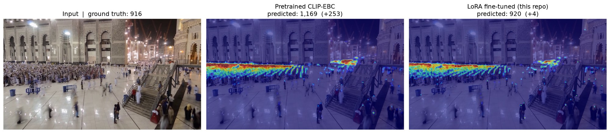
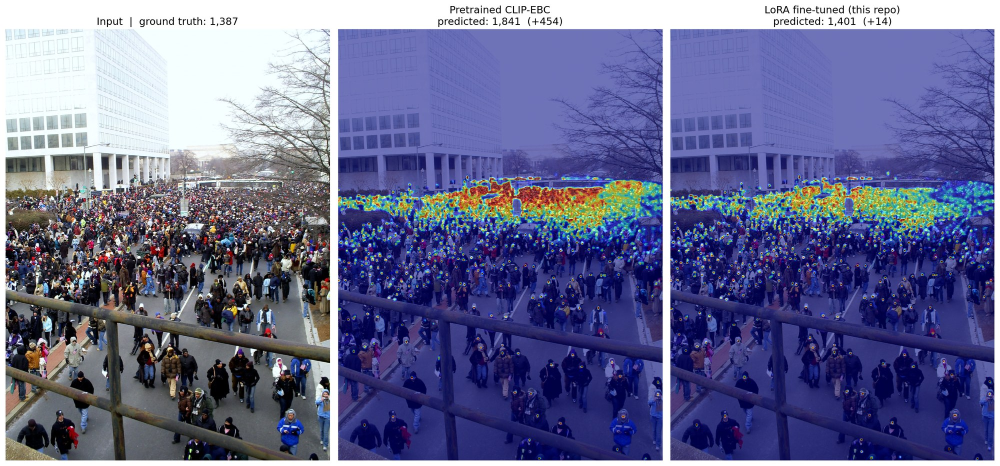
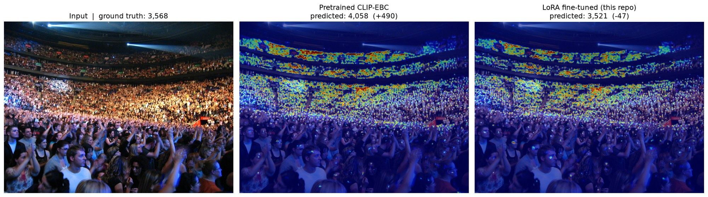
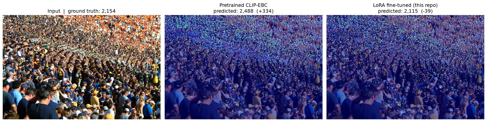

# Mosque Crowd Counting: CLIP-EBC + LoRA

Fine-tuning [CLIP-EBC](https://github.com/Yiming-M/CLIP-EBC) (ViT-B/16) with LoRA and deep visual prompts to count people in dense prayer crowds, from ground-level cameras to aerial views. The model predicts a **density map**, not identities: no faces, no tracking of individuals.



*A mosque courtyard during night prayer, from the public UCF-QNRF test set (`img_0271`, ground truth 916). The pretrained model over-counts the prayer rows (1,169); the fine-tuned model predicts 920.*

## Results

All models are evaluated on the **full UCF-QNRF test set (334 images)** with the same native-resolution protocol: each image is tiled into 224×224 windows at its original size, and the window densities are summed.

| Model | Bins | MAE ↓ | RMSE ↓ | Mean error |
|---|---|---|---|---|
| Original pretrained CLIP-EBC ViT-B/16 | 5 | 130.00 | 694.16 | +80.24 |
| **LoRA fine-tune v3 (this repo)** | **7** | **100.06** | **164.79** | **−5.85** |

- **23% lower MAE** and **76% lower RMSE** than the pretrained model
- Near-zero mean error: the original over-counts; the fine-tuned model is calibrated
- **0.43% of parameters trained** (688,641 / 161,420,801): LoRA rank 16 on Q/V + out-projection, 32 deep VPT tokens; decoder frozen

Every version I trained, under the same protocol ([results/model_comparison.csv](results/model_comparison.csv)):

| Version | Training data | UCF-QNRF MAE |
|---|---|---|
| Pretrained baseline | UCF-QNRF | 130.00 |
| v0: aerial + Hajj fine-tune | 812 images + 350 QNRF replay | 1096.33 |
| Site-only fine-tune | one mosque site | 452.40 |
| v1: all sources, 8 bins | 10,482 images | 175.84 |
| v2: native-scale crops, max 5 per cell | 10,482 images | 103.79 |
| **v3: wider bins, max 9+ per cell** | **10,482 images** | **100.06** |

Per-image predictions for the baseline and v3: [results/qnrf_per_image.csv](results/qnrf_per_image.csv).

### More test images

| | |
|---|---|
|  |  |
|  | |

| Image | Ground truth | Pretrained | Fine-tuned |
|---|---|---|---|
| img_0271 | 916 | 1,169 (+253) | **920 (+4)** |
| img_0104 | 1,387 | 1,841 (+454) | **1,401 (+14)** |
| img_0308 | 3,568 | 4,058 (+490) | **3,521 (−47)** |
| img_0303 | 2,154 | 2,488 (+334) | **2,115 (−39)** |

These four were picked to show the fix, not at random. The test-set average is in the Results table above.

## What went wrong, and how I found it

**1. Fine-tuning made the model 2.5× worse on dense crowds.**
The first fine-tune (aerial + Hajj data) adapted well in-domain but predicted 603k people on a test set that has 240k. More data didn't fix it. The cause was the **count bins**: CLIP-EBC classifies each 8×8 cell into a count bin, and bins calibrated for sparse aerial scenes saturate on dense crowds, so every packed cell hit the top bin. I wrote [`compute_bins.py`](training/compute_bins.py) and [`audit_density_histogram.py`](training/audit_density_histogram.py) to measure the real per-cell count distribution across all 10,482 images (16.4M cells). Then I re-derived bins and anchors from it: 7 bins, with a per-cell cap of 10 that clips only 0.003% of cells.

**2. The evaluation protocol was lying.**
An earlier evaluation resized every test image to 224×224 before predicting. Under that protocol the pretrained model scored 280 and the 8-bin model 130, so a worse model looked like a big win. CLIP-EBC is trained on native-scale crops, so I rewrote the evaluation to tile native-resolution images ([`eval/test_qnrf.py`](eval/test_qnrf.py)). Then I re-ran **every** earlier model under it before comparing anything.

**3. Training crops had to match inference scale.**
v2 switched training to clamped random-resized crops at native pixel scale (0.5–3.0×, capped at 90% of the short side), so per-cell densities during training match what sliding-window inference sees. This was the first version to beat the baseline.

## Training data

~10,482 images in one pool, with public datasets converted to a common `images/` + `mats/` point-annotation format:

| Source | Type |
|---|---|
| [UCF-QNRF](https://www.crcv.ucf.edu/data/ucf-qnrf/), [JHU-Crowd++](http://www.crowd-counting.com/), [NWPU-Crowd](https://gjy3035.github.io/NWPU-Crowd-Sample-Code/) | dense ground-level crowds |
| [DroneCrowd](https://github.com/VisDrone/DroneCrowd), [UP-COUNT](https://up-count.github.io/) (593 sampled frames) | aerial |
| [HAJJv2](https://github.com/KAU-Smart-Crowd/HAJJv2_dataset) (219 frames) | Hajj crowds |
| Mosque site cameras | **proprietary, not included** |

Drone frames are oversampled to 30% of each batch (`WeightedRandomSampler`). To train on public data only, remove `./site_data` from `DATA_DIRS` in [`training/train_lora_vit_b16.py`](training/train_lora_vit_b16.py).

## Repository layout

```
training/   train_lora_vit_b16.py, my_dataset.py, lora_utils.py, compute_bins.py, audit_density_histogram.py
eval/       test_qnrf.py: full UCF-QNRF evaluation, writes an Excel report
demo/       predict_image.py: density-map figure for any image (made the images above)
results/    model_comparison.csv, qnrf_per_image.csv
patches/    one-line fix for upstream CLIP-EBC (see Setup)
```

## Setup

```bash
# 1. CLIP-EBC at the commit this was built on, plus a one-line fix:
#    upstream format_count() breaks on "between X and Y" prompts, which any
#    bin wider than one count (e.g. 4-5, 6-8) needs.
git clone https://github.com/Yiming-M/CLIP-EBC
cd CLIP-EBC
git checkout b52a5944bd75beed34fd3d0da516aa833ae63354
git apply ../mosque-crowd-counting/patches/clip-ebc-format-count.patch
cd ..

# 2. Python deps
pip install -r mosque-crowd-counting/requirements.txt
```

Pretrained weights: the original UCF-QNRF CLIP-EBC ViT-B/16 (word prompts) checkpoint from the CLIP-EBC repository.

**Density map for one image**
```bash
python demo/predict_image.py --clip-ebc ../CLIP-EBC \
    --checkpoint path/to/finetuned.pth --baseline path/to/clip_ebc_vit_b16.pth \
    --image UCF-QNRF_ECCV18/Test/img_0104.jpg --out docs/images/qnrf_img_0104.png
```

**Full UCF-QNRF evaluation**
```bash
PYTHONPATH=../CLIP-EBC python eval/test_qnrf.py --qnrf-dir UCF-QNRF_ECCV18/Test \
    --baseline path/to/clip_ebc_vit_b16.pth --checkpoint "v3=path/to/finetuned.pth"
```

**Training:** run from inside the CLIP-EBC checkout, with the dataset folders next to it:
```bash
python ../mosque-crowd-counting/training/train_lora_vit_b16.py
```

## Weights

The fine-tuned weights are not distributed: part of the training data is proprietary site footage. Everything else (code, bins, protocol, per-image results) is here, so you can retrain on the public sources.

## Stack

PyTorch · CLIP-EBC · LoRA (loralib) · Visual Prompt Tuning · DACE loss (CE + DMCount) · NumPy / SciPy · Matplotlib

## Credits

- CLIP-EBC: Yiming Ma et al., MIT License. Base model and training framework.
- UCF-QNRF: H. Idrees et al., *Composition Loss for Counting, Density Map Estimation and Localization in Dense Crowds*, ECCV 2018. Test images shown above.
- JHU-Crowd++, NWPU-Crowd, DroneCrowd, UP-COUNT, HAJJv2: see links in *Training data*.
