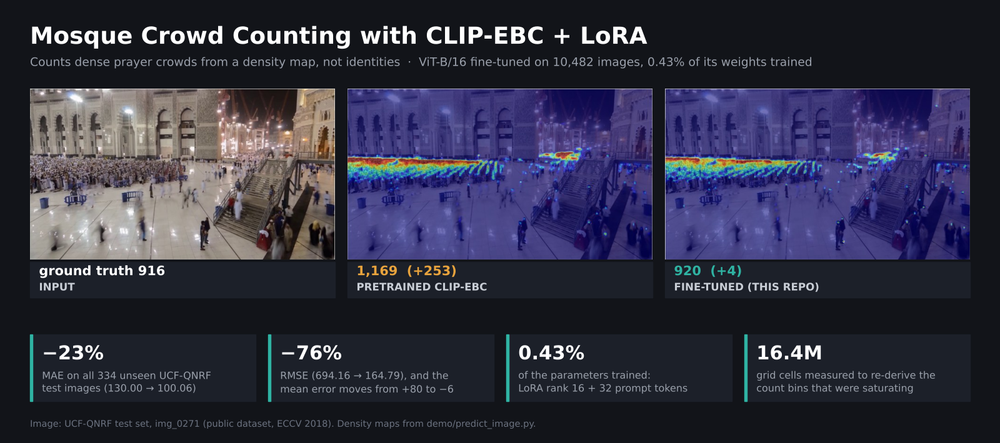
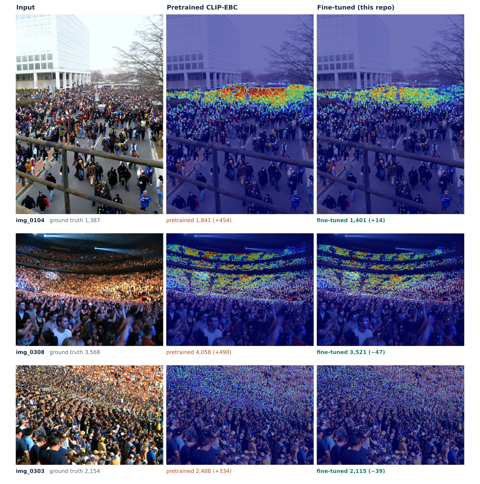

# Mosque Crowd Counting with CLIP-EBC + LoRA

**Fine-tuning [CLIP-EBC](https://github.com/Yiming-M/CLIP-EBC) (ViT-B/16) to count dense prayer crowds, from ground-level cameras to aerial views.** On all 334 UCF-QNRF test images it cuts MAE by **23%** and RMSE by **76%** against the pretrained model, while training only **0.43%** of the weights. The model predicts a **density map**, not identities: no faces, no tracking of individuals.



<sub>A mosque courtyard during night prayer, from the public UCF-QNRF test set (<code>img_0271</code>, ground truth 916). The pretrained model over-counts the prayer rows (1,169); the fine-tuned model predicts 920.</sub>

## At a glance

- **The problem:** Off-the-shelf crowd counters over-count packed prayer rows, and the first fine-tune made dense crowds **2.5× worse**.
- **What I built:** A LoRA + deep visual prompt fine-tune of CLIP-EBC on 10,482 images from six public sources plus site footage, with count bins re-derived from the data.
- **Results:** MAE **130.00 → 100.06**, RMSE **694.16 → 164.79**, mean error **+80.24 → −5.85** on unseen UCF-QNRF test images.
- **What I found:** The count bins were saturating on dense crowds, and the evaluation protocol was making a worse model look better.

## Results

Every model is evaluated on the **full UCF-QNRF test set (334 images)** with the same native-resolution protocol: each image is tiled into 224×224 windows at its original size, and the window densities are summed.

| Model | Bins | MAE ↓ | RMSE ↓ | Mean error |
|---|---:|---:|---:|---:|
| Original pretrained CLIP-EBC ViT-B/16 | 5 | 130.00 | 694.16 | +80.24 |
| **LoRA fine-tune v3 (this repo)** | **7** | **100.06** | **164.79** | **−5.85** |

- **23% lower MAE** and **76% lower RMSE** than the pretrained model.
- **Near-zero mean error:** the original over-counts; the fine-tuned model is calibrated.
- **0.43% of parameters trained** (688,641 of 161,420,801): LoRA rank 16 on Q/V and the out-projection, 32 deep VPT tokens, decoder frozen.



<sub>These images were picked to show the fix, not at random. The test-set average is in the table above; per-image predictions for the baseline and v3 are in <a href="results/qnrf_per_image.csv"><code>results/qnrf_per_image.csv</code></a>.</sub>

<details>
<summary><b>Every version I trained, under the same protocol</b></summary>

| Version | Training data | UCF-QNRF MAE |
|---|---|---:|
| Pretrained baseline | UCF-QNRF | 130.00 |
| v0: aerial + Hajj fine-tune | 812 images + 350 QNRF replay | 1096.33 |
| Site-only fine-tune | one mosque site | 452.40 |
| v1: all sources, 8 bins | 10,482 images | 175.84 |
| v2: native-scale crops, max 5 per cell | 10,482 images | 103.79 |
| **v3: wider bins, max 9+ per cell** | **10,482 images** | **100.06** |

Source: [`results/model_comparison.csv`](results/model_comparison.csv).

</details>

## What went wrong, and how I found it

### 1. Fine-tuning made the model 2.5× worse on dense crowds

The first fine-tune (aerial + Hajj data) adapted well in-domain but predicted 603k people on a test set that has 240k. More data didn't fix it. The cause was the **count bins**: CLIP-EBC classifies each 8×8 cell into a count bin, and bins calibrated for sparse aerial scenes saturate on dense crowds, so every packed cell hit the top bin.

I wrote [`compute_bins.py`](training/compute_bins.py) and [`audit_density_histogram.py`](training/audit_density_histogram.py) to measure the real per-cell count distribution across all 10,482 images (**16.4M cells**), then re-derived bins and anchors from it: 7 bins, with a per-cell cap of 10 that clips only 0.003% of cells.

### 2. The evaluation protocol was lying

An earlier evaluation resized every test image to 224×224 before predicting. Under that protocol the pretrained model scored 280 and the 8-bin model 130, so a worse model looked like a big win. CLIP-EBC is trained on native-scale crops, so I rewrote the evaluation to tile native-resolution images ([`eval/test_qnrf.py`](eval/test_qnrf.py)), then re-ran **every** earlier model under it before comparing anything.

### 3. Training crops had to match inference scale

v2 switched training to clamped random-resized crops at native pixel scale (0.5–3.0×, capped at 90% of the short side), so per-cell densities during training match what sliding-window inference sees. This was the first version to beat the baseline.

## Is the test set really unseen?

The training pool mixes UCF-QNRF Train with JHU-Crowd++ and NWPU-Crowd, and all three were collected from the web. So [`eval/check_overlap.py`](eval/check_overlap.py) fingerprints every image with a 64-bit and a 256-bit difference hash and compares all 334 test images against 10,682 public images (QNRF Train, all of JHU-Crowd++, all of NWPU-Crowd).

**5 test images have an exact or near-exact copy** ([`results/overlap_check.csv`](results/overlap_check.csv)): three in JHU-Crowd++, one in NWPU-Crowd train, and one inside UCF-QNRF's own Train split (that one also helps the pretrained baseline). Removing them doesn't change the result:

| Test set | Fine-tuned MAE | Pretrained MAE | Reduction |
|---|---:|---:|---:|
| All 334 images | 100.06 | 130.00 | 23.0% |
| Without the 4 copies in JHU / NWPU | 100.19 | 130.61 | 23.3% |
| Without all 5 | 100.43 | 130.73 | 23.2% |

None of the four images shown above is near any training image (closest 64-bit hash distance ≥ 15; copies score 0–1).

## Training data

About 10,482 images in one pool, with the public datasets converted to a common `images/` + `mats/` point-annotation format:

| Source | Type |
|---|---|
| [UCF-QNRF](https://www.crcv.ucf.edu/data/ucf-qnrf/), [JHU-Crowd++](http://www.crowd-counting.com/), [NWPU-Crowd](https://gjy3035.github.io/NWPU-Crowd-Sample-Code/) | dense ground-level crowds |
| [DroneCrowd](https://github.com/VisDrone/DroneCrowd), [UP-COUNT](https://up-count.github.io/) (593 sampled frames) | aerial |
| [HAJJv2](https://github.com/KAU-Smart-Crowd/HAJJv2_dataset) (219 frames) | Hajj crowds |
| Mosque site cameras | **proprietary, not included** |

**Splits used:** UCF-QNRF **Train only** (1,201 images); its 334-image Test split was never used for training, so every number above is on unseen images. NWPU-Crowd train + val (3,609). JHU-Crowd++ **all splits including its test set** (4,360), so this model should not be evaluated on JHU-Crowd++.

Drone frames are oversampled to 30% of each batch (`WeightedRandomSampler`). To train on public data only, remove `./site_data` from `DATA_DIRS` in [`training/train_lora_vit_b16.py`](training/train_lora_vit_b16.py).

## Run it

```bash
# 1. CLIP-EBC at the commit this was built on, plus a one-line fix:
#    upstream format_count() breaks on "between X and Y" prompts, which any
#    bin wider than one count (e.g. 4-5, 6-8) needs.
git clone https://github.com/Yiming-M/CLIP-EBC
cd CLIP-EBC
git checkout b52a5944bd75beed34fd3d0da516aa833ae63354
git apply ../mosque-crowd-counting/patches/clip-ebc-format-count.patch
cd ..

# 2. Python deps
pip install -r mosque-crowd-counting/requirements.txt
```

Pretrained weights: the original UCF-QNRF CLIP-EBC ViT-B/16 (word prompts) checkpoint from the CLIP-EBC repository.

<details>
<summary><b>Density map for one image, full evaluation, training</b></summary>

**Density map for one image**
```bash
python demo/predict_image.py --clip-ebc ../CLIP-EBC \
    --checkpoint path/to/finetuned.pth --baseline path/to/clip_ebc_vit_b16.pth \
    --image UCF-QNRF_ECCV18/Test/img_0104.jpg --out docs/images/qnrf_img_0104.png
```

**Full UCF-QNRF evaluation**
```bash
PYTHONPATH=../CLIP-EBC python eval/test_qnrf.py --qnrf-dir UCF-QNRF_ECCV18/Test \
    --baseline path/to/clip_ebc_vit_b16.pth --checkpoint "v3=path/to/finetuned.pth"
```

**Training:** run from inside the CLIP-EBC checkout, with the dataset folders next to it:
```bash
python ../mosque-crowd-counting/training/train_lora_vit_b16.py
```

**README figures:** `python docs/make_figures.py` rebuilds the cover and the comparison grid from the figures in `docs/images/`.

</details>

<details>
<summary><b>Repository layout</b></summary>

```
training/   train_lora_vit_b16.py, my_dataset.py, lora_utils.py, compute_bins.py, audit_density_histogram.py
eval/       test_qnrf.py: full UCF-QNRF evaluation, writes an Excel report
            check_overlap.py: finds test images duplicated in the training data
demo/       predict_image.py: density-map figure for any image (made the images above)
results/    model_comparison.csv, qnrf_per_image.csv, overlap_check.csv
patches/    one-line fix for upstream CLIP-EBC (see Run it)
docs/       README figures; make_figures.py lays them out
```

</details>

**Weights** are not distributed: part of the training data is proprietary site footage. Everything else (code, bins, protocol, per-image results) is here, so you can retrain on the public sources.

## Stack and credits

PyTorch · CLIP-EBC · LoRA (loralib) · Visual Prompt Tuning · DACE loss (CE + DMCount) · NumPy / SciPy · Matplotlib

- CLIP-EBC: Yiming Ma et al., MIT License. Base model and training framework.
- UCF-QNRF: H. Idrees et al., *Composition Loss for Counting, Density Map Estimation and Localization in Dense Crowds*, ECCV 2018. Test images shown above.
- JHU-Crowd++, NWPU-Crowd, DroneCrowd, UP-COUNT, HAJJv2: see the links in *Training data*.

---

**More of my computer-vision work:** [Prayer-area tracking](https://github.com/hamzamshabi/prayer-area-tracking) (counts only inside a moving prayer area) · [Industrial fire & smoke detection](https://github.com/hamzamshabi/industrial-fire-smoke-detection) (YOLO26 + an alarm layer)
